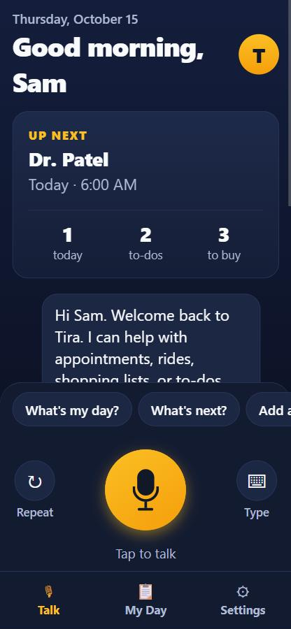
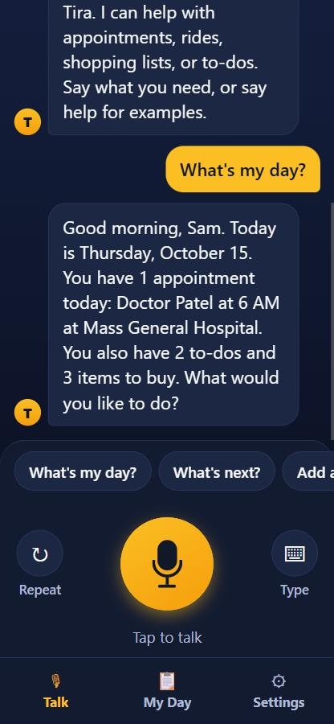
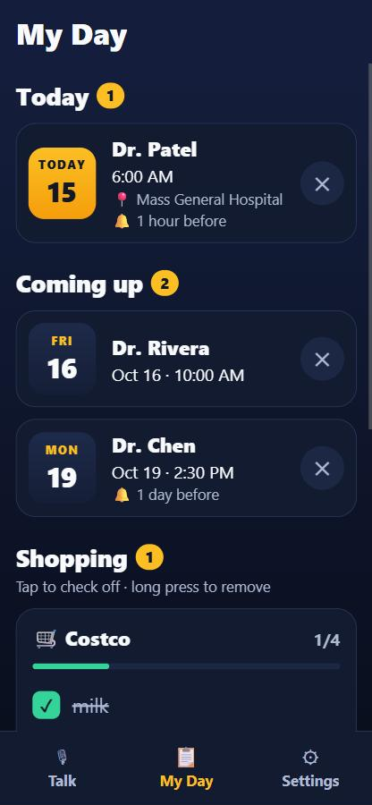
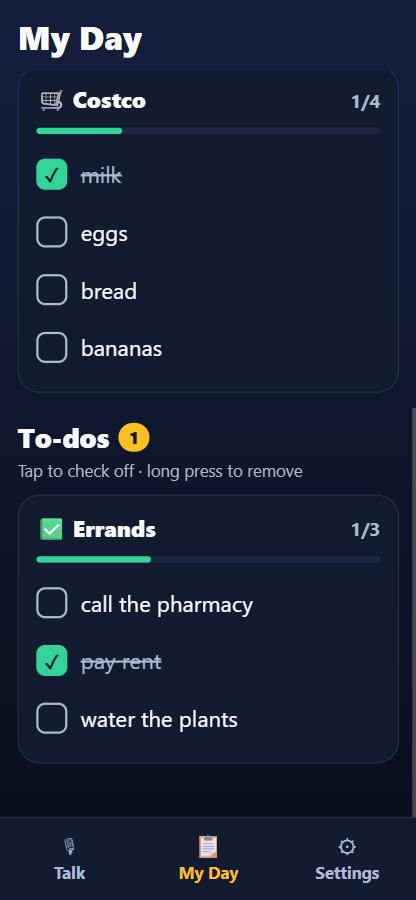
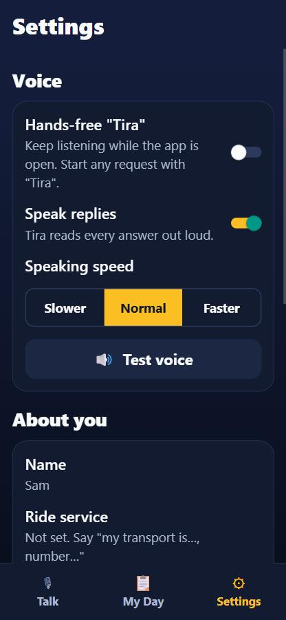

<p align="center">
  
</p>

<h1 align="center">Tira</h1>

<p align="center">
  A voice-first phone assistant for appointments, rides, shopping lists, and to-dos.<br/>
  Built for people who'd rather talk than tap: large text, high contrast, and every answer spoken aloud.
</p>

Start any request with **"Tira"**:

> "Tira, add an appointment with Dr. Smith tomorrow at 2 PM"
> "Tira, what's on my Costco shopping list?"
> "Tira, request a ride to my appointment"

Tira reuses the dialogue engine from the **Day Buddy** Alexa skill. It runs entirely on the
phone: you don't need Alexa, AWS, or a server, and your data never leaves the device.

## Screenshots

<table>
  <tr>
    <td align="center" width="33%"><br/><b>Talk</b><br/><sub>Greeting, Up next card, big mic button</sub></td>
    <td align="center" width="33%"><br/><b>Daily briefing</b><br/><sub>"Tira, what's my day?"</sub></td>
    <td align="center" width="33%"><br/><b>My Day: appointments</b><br/><sub>Today and coming up, with reminders</sub></td>
  </tr>
  <tr>
    <td align="center"><br/><b>My Day: lists</b><br/><sub>Tap to check off, long-press to remove</sub></td>
    <td align="center"><br/><b>Settings</b><br/><sub>Hands-free, voice speed, test voice</sub></td>
    <td align="center"><br/><b>App icon</b><br/><sub>Also used for the splash screen</sub></td>
  </tr>
</table>

<sub>Screenshots are from the web build (`npm run web`) at phone size. On a phone, the app looks the same, apart from the system status bar.</sub>

## Features

- 🗓️ **Appointments:** add, list, find, reschedule and delete by voice. Reminders arrive as phone notifications.
- 🌅 **Daily briefing:** "What's my day?" reads today's appointments, open to-dos and your shopping count.
- ⏭️ **What's next:** your next appointment in one sentence.
- 🛒 **Shopping lists** by store, and ✅ **to-do lists** by name: add, read, check off, clear.
- 🚗 **Rides:** saves your transport service, confirms the details, then opens the dialer and tells you what to say.
- 🔁 **Repeat:** "Repeat that", or the Repeat button, replays the last answer, even mid-question.
- 🎙️ **Hands-free wake word:** with the app open, say "Tira, …" without touching the screen.
- ♿ **Accessible:** large type, high contrast, screen-reader labels on everything, and a haptic tap when Tira hears you.
- 🔒 **Private:** everything is stored on the phone. No account, no server.

---

## Contents

1. [Prerequisites](#1-prerequisites)
2. [Install](#2-install)
3. [Check the engine works](#3-check-the-engine-works)
4. [Run the app](#4-run-the-app)
5. [Use Tira](#5-use-tira)
6. [Configure](#6-configure)
7. [Build an installable APK](#7-build-an-installable-apk)
8. [Publish to Google Play](#8-publish-to-google-play)
9. [Troubleshooting](#9-troubleshooting)
10. [How it works](#10-how-it-works)
11. [Project layout](#11-project-layout)
12. [Changelog](#12-changelog)

---

## 1. Prerequisites

| Tool | Version | Needed for |
|---|---|---|
| [Node.js](https://nodejs.org) | 20 or newer (LTS) | Everything |
| [Git](https://git-scm.com) | any | Cloning the project |
| A phone | Android 12+ or iOS 17+ | Trying the app |
| [Expo account](https://expo.dev/signup) (free) | — | Cloud builds (EAS) |
| [Android Studio](https://developer.android.com/studio) | latest | *Optional:* building on your own PC instead of in the cloud |

Check Node is installed:

```bash
node -v
```

---

## 2. Install

```bash
git clone <your-repo-url> tira
```

```bash
cd tira
```

```bash
npm install
```

---

## 3. Check the engine works

The conversation engine runs under plain Node, so you can test it without a phone:

```bash
npm test
```

You should see `16 passed, 0 failed`. To print every turn of every conversation:

```bash
npm run test:verbose
```

---

## 4. Run the app

Pick the option that suits you. They differ in which features work:

| Option | Mic / voice input | Spoken replies | Notifications | Setup time |
|---|---|---|---|---|
| **A. Expo Go** | ❌ (type instead) | ✅ | ✅ | ~2 min |
| **B. Cloud build (EAS)** | ✅ | ✅ | ✅ | ~15 min |
| **C. Local build (Android Studio)** | ✅ | ✅ | ✅ | ~30 min first time |
| **D. Web browser** | ✅ in Chrome | ✅ | ❌ | ~1 min |

Voice input uses a native speech-recognition module. Expo Go doesn't include that module,
which is why the mic needs option B or C.

### A. Expo Go (quickest look)

1. Install **Expo Go** on your phone (Play Store / App Store).
2. Make sure the phone and computer are on the **same Wi-Fi**.
3. Start the dev server:
   ```bash
   npm run start:go
   ```
4. Scan the QR code: on Android, from inside Expo Go; on iPhone, with the Camera app.

If the phone can't connect (common on school or office Wi-Fi), use a tunnel:

```bash
npx expo start --go --tunnel
```

### B. Cloud build with EAS (full voice, no Android Studio)

1. Log in to Expo:
   ```bash
   npx eas-cli@latest login
   ```
2. Build an installable Android APK:
   ```bash
   npx eas-cli@latest build --platform android --profile preview
   ```
   On the first run, answer **Yes** when asked to create an EAS project and a signing key.
3. When the build finishes (10–15 minutes), scan the QR code or open the link on your
   phone and install the APK. Allow "install unknown apps" for your browser when Android asks.

This APK runs on its own. It doesn't need your computer or a dev server.

> **iPhone:** iOS builds need a paid Apple Developer account ($99/year). With one, run the
> same command with `--platform ios`. You can't install iOS builds from Windows without EAS.

### C. Local build with Android Studio

1. Install Android Studio, then from its SDK Manager install the **Android SDK** and
   **Platform Tools**.
2. Set the environment variable `ANDROID_HOME` to the SDK folder
   (on Windows usually `C:\Users\<you>\AppData\Local\Android\Sdk`) and add
   `%ANDROID_HOME%\platform-tools` to `PATH`.
3. On your phone, turn on **Developer options → USB debugging** and connect it by USB.
   Or start an emulator from Android Studio's Device Manager.
4. Build and install:
   ```bash
   npm run android
   ```
   This creates the `android/` folder, compiles the app, installs it, and starts the dev server.
   After that, start the dev server on its own with:
   ```bash
   npm start
   ```

### D. Web browser (UI check)

```bash
npm run web
```

Opens at http://localhost:8081. Voice input works in Chrome; reminders and the phone dialer don't.

---

## 5. Use Tira

### Screens

- **Talk:** a greeting and an **Up next** card at the top. Tap the big mic and speak, tap a quick-action chip, or press **Type** to use the keyboard. **Repeat** replays Tira's last answer.
- **My Day:** today's and upcoming appointments (tap ✕ to delete one, which also cancels its reminder) and your lists with progress bars. Tap an item to check it off; long-press to remove it.
- **Settings:** hands-free mode, speaking speed, **Test voice**, your saved info, and erasing all data.

### Things to say

| Area | Examples |
|---|---|
| Appointments | "Add an appointment with doctor Patel next Friday at 11 am" · "What appointments do I have?" · "When do I see doctor Smith?" · "Reschedule my appointment with doctor Smith to Monday at 3 pm" · "Delete my appointment with doctor Smith" |
| Shopping | "Add milk and eggs to my Target shopping list" · "What's on my Target list?" · "Mark milk as done on my Target list" · "Clear completed from my Target list" |
| To-dos | "Add call the pharmacy to my errands to do list" · "What's on my to do list?" |
| Rides | "My transport is Care Ride, number 555 123 4567" (one-time setup) · "Request a ride to my appointment" · "Request a ride to the library tomorrow at 10 am" |
| You | "My name is Sam" · "What is my name?" · "Use brief lists" |
| Your day | "What's my day?" (spoken briefing: today's appointments, to-dos, shopping) · "What's next?" · "What time is it?" · "What's the date?" |
| Anytime | "Repeat that" (works mid-question too) · "Help" · "Cancel" (stops the current question) · "Stop" · "Thank you" |

### Voice behavior

- **Wake word:** requests can start with "Tira", "Hey Tira", or common mis-hearings like
  "Tiara". When you tap the mic, you don't need the wake word.
- **Follow-up questions:** when Tira asks something ("What time?"), the mic reopens
  automatically, so you can just answer.
- **Hands-free (Settings):** Tira keeps listening while the app is open and only responds to
  sentences that start with "Tira". It does **not** listen when the app is in the background
  or the phone is locked.
- **Rides:** Tira confirms the details, then opens your phone's dialer to your ride service
  and tells you what to say when they answer.
- **Reminders:** when you add an appointment, Tira offers a reminder (15 minutes, 1 hour, or
  1 day before) as a phone notification. Allow notifications when asked.

---

## 6. Configure

### Rename the assistant or change the wake word

Edit `src/engine/brand.js`:

```js
displayName: 'Tira',          // what it calls itself
invocationName: 'tira',       // the wake word
wakeWordVariants: ['tira', 'tiara', 'tyra', ...], // speech-to-text mis-hearings to accept
```

Also update `name` in `app.json` so the home-screen label matches.

### App identity (do this before publishing)

In `app.json`:

| Key | Current | Change to |
|---|---|---|
| `expo.android.package` | `com.tira.assistant` | A unique ID you own, e.g. `com.yourname.tira`. **Can't be changed after the first Play Store upload.** |
| `expo.ios.bundleIdentifier` | `com.tira.assistant` | Same as above |
| `expo.icon`, `expo.android.adaptiveIcon.*` | Tira icon in `assets/` (amber orb on navy) | Optional: your own 1024×1024 PNGs with the same file names |

### Microphone and speech permission text

These are the messages users see when the app first asks for the mic. Edit them under the
`expo-speech-recognition` plugin in `app.json`. After changing native settings like these,
rebuild the app (option B or C). A JavaScript reload isn't enough.

---

## 7. Build an installable APK

To share a test build with friends (outside the Play Store):

```bash
npx eas-cli@latest build --platform android --profile preview
```

Send them the link EAS prints. The build profiles live in `eas.json`:

| Profile | Output | Use |
|---|---|---|
| `preview` | `.apk` | Install directly on phones for testing |
| `production` | `.aab` | Upload to Google Play (version number auto-increments) |

---

## 8. Publish to Google Play

### Before you start

- [ ] Set your own `android.package` in `app.json` (see [Configure](#6-configure))
- [x] App icon and splash screen (done; the Play Store icon is `assets/store-icon-512.png`)
- [ ] Publish a privacy policy page (required: Tira uses the microphone and stores personal data)
- [ ] Prepare store graphics: 512×512 icon, 1024×500 feature graphic, at least 2 phone screenshots

### Steps

1. **Developer account:** sign up at [play.google.com/console](https://play.google.com/console)
   ($25 one-time fee plus ID verification, which can take a few days).
2. **Build the release bundle:**
   ```bash
   npx eas-cli@latest build --platform android --profile production
   ```
3. **Create the app** in Play Console and complete these sections:
   - **Data safety:** audio is processed for speech recognition by the phone's speech
     service; name, phone numbers, and appointments are stored on the device only; nothing is
     sent to your servers or shared.
   - **Content rating** questionnaire, **target audience** (adults), **ads** (none),
     **privacy policy URL**, **app access** (no login needed).
4. **First upload by hand:** Testing → Internal testing → Create release → upload the `.aab`
   from step 2. Google requires the very first upload to go through the website.
5. **Later uploads from the terminal** (needs a Google service-account key; EAS walks you through it):
   ```bash
   npx eas-cli@latest submit --platform android --profile production
   ```
   `eas.json` sends these to the internal track as a draft, so nothing goes public by accident.
6. **Closed test:** new personal developer accounts must run a closed test with **at least
   12 testers for 14 days in a row** before they can apply for production.
7. **Apply for production:** Dashboard → Apply for production. Review usually takes a few
   days to a week.

> Tira doesn't use the exact-alarm permission, because Google restricts it to alarm-clock and
> calendar apps. As a result, reminders may arrive a few minutes late.

---

## 9. Troubleshooting

| Problem | Fix |
|---|---|
| The mic button is greyed out, with "Voice input needs a development build" | You're in Expo Go. Use option B or C. |
| "Tira needs microphone and speech recognition permission" | Phone Settings → Apps → Tira → Permissions → allow Microphone. On Android, also make sure the **Google** app is installed and up to date (it provides speech recognition). |
| The phone can't connect to the dev server | Use the same Wi-Fi as the computer, or run `npx expo start --tunnel`. |
| No reminder notification | Allow notifications for Tira. Reminders less than the chosen lead time away aren't set (Tira tells you). They may arrive a few minutes late. |
| Hands-free beeps every few seconds (Android) | Android plays a tone each time recognition restarts. Turn hands-free off and use the mic button instead. |
| Hands-free doesn't respond | Start the sentence with "Tira". Hands-free stops when the app is backgrounded. |
| `npm run android` says SDK not found | Set `ANDROID_HOME` (see option C), or use the cloud build (option B). |
| Strange errors after changing `app.json` or installing a package | Rebuild the app, then run `npx expo start --clear`. |
| Version or dependency warnings | `npx expo-doctor`, then `npx expo install --fix` |

---

## 10. How it works

```
You speak ─► expo-speech-recognition ─► "Tira, add milk to my Target list"
                                             │  strip the wake word
                                             ▼
                              src/engine  (Day Buddy dialogue engine)
                              classify ─► dispatch ─► multi-turn flows
                                             │
                  ┌──────────────────────────┼──────────────────────────┐
                  ▼                          ▼                          ▼
       store (AsyncStorage)      reminders (expo-notifications)   calls (phone dialer)
                                             │
Tira speaks ◄── expo-speech ◄── "I've added milk to your Target list."
```

### Differences from Day Buddy

| Day Buddy (Alexa skill) | Tira (phone app) |
|---|---|
| "Alexa, open day buddy" | "Tira, …" or tap the mic |
| Alexa's NLU picks intents and slots | The full transcript goes to the engine's local classifier |
| DynamoDB | AsyncStorage (`src/engine/store`, same function names) |
| Alexa Reminders API | Local notifications |
| Twilio calls you, then bridges to transport | Opens the dialer to your transport service |
| Dates computed in UTC on Lambda | Dates computed in the phone's local time |

---

## 11. Project layout

```
tira/
├── app.json                 # App name, package ID, permissions, plugins
├── eas.json                 # Cloud build + Play Store submit profiles
├── assets/                  # App icon, adaptive icons, splash, store icon
├── docs/screenshots/        # Screenshots used in this README
├── src/
│   ├── app/                 # Screens (Expo Router)
│   │   ├── _layout.js       # Bottom tabs
│   │   ├── index.js         # Talk
│   │   ├── today.js         # My Day
│   │   └── settings.js      # Settings
│   ├── tira/                # App glue
│   │   ├── TiraProvider.js  # Conversation state + voice loop (wake word, follow-ups)
│   │   ├── voice.js         # Speech in / speech out
│   │   ├── device.js        # Storage, notifications, dialer
│   │   ├── confirm.js       # Yes/no dialogs (phone + web)
│   │   ├── theme.js         # High-contrast colors, gradients, large type
│   │   └── components/
│   │       └── MicOrb.js    # Animated talk button
│   └── engine/              # Ported Day Buddy engine (plain JS, runs in Node too)
│       ├── index.js         # createTira(): text in → speech out
│       ├── extras.js        # Daily briefing, what's next, time/date, repeat, thanks
│       ├── brand.js         # Name + wake word
│       ├── ask.js           # Stand-in for the few Alexa SDK helpers the engine uses
│       ├── platform.js      # Device hooks injected by the app
│       ├── store/           # On-device database
│       ├── dialogue/        # Classifier, dispatcher, multi-turn flows
│       └── modules/         # Appointments, shopping, to-do, rides, profile
└── test/
    ├── conversation.test.js # 16 scripted conversations (npm test)
    └── chat.js              # Terminal chat with spoken replies (npm run chat)
```

### Scripts

| Command | What it does |
|---|---|
| `npm test` | Run the scripted conversation tests |
| `npm run test:verbose` | Same, printing every turn |
| `npm run chat` | Talk to Tira in the terminal. Replies are spoken aloud with your computer's voice (no phone needed; data resets on quit) |
| `npm run chat -- --mute` | Same, text only |
| `npm start` | Start the dev server (for a development build) |
| `npm run start:go` | Start the dev server for Expo Go |
| `npm run android` | Build and run on Android locally (needs Android Studio) |
| `npm run ios` | Build and run on iOS locally (needs a Mac with Xcode) |
| `npm run web` | Run in the browser |
| `npm run lint` | Lint the code |

---

## 12. Changelog

### v1.1: features and redesign

**New things to say**
- "What's my day?" (also "brief me", "good morning, what's on today?") gives a spoken daily briefing.
- "What's next?" names your next appointment.
- "Repeat that" / "say that again" works anywhere, including in the middle of a question.
- "What time is it?", "What's the date?" and "Thank you".

**Talk screen**
- A greeting with your name and today's date.
- An **Up next** card: your next appointment, plus counts for today, to-dos and items to buy. Tap it to open My Day.
- A redesigned mic button: an amber orb that pulses green while listening and "breathes" while Tira speaks.
- Scrollable quick-action chips, plus **Repeat** and **Type** buttons.

**My Day**
- Appointments split into **Today** and **Coming up**, with date tiles, location and reminder details.
- Delete an appointment with ✕ (it asks first). This also cancels its reminder.
- Lists show progress bars. Tap to check off, long-press to remove.

**Settings**
- **Test voice** button and an **About** section.

**App**
- New app icon, Android adaptive and themed icons, a splash screen, and the 512px Play Store icon (`assets/store-icon-512.png`).
- The tab bar now makes room for the phone's gesture bar, and labels are no longer clipped.
- Updated Expo packages to the latest SDK 57 patch versions.
- Tests: 16 scripted conversations (up from 12).

### v1.0: first version
- Ported the Day Buddy Alexa skill's dialogue engine to a standalone Expo app with the wake word "Tira".
- DynamoDB → on-device storage; Alexa Reminders → local notifications; Twilio bridge → phone dialer.
- Talk, My Day and Settings screens; hands-free mode; follow-up questions reopen the mic.
- Fixed UTC ride dates, garbled ride requests, ISO dates in speech, store names being missed in shopping requests, and a storage loading race.
- Terminal chat with spoken replies (`npm run chat`).
